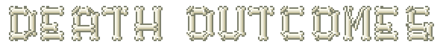

<div align="center">



**Trophies, tracking compasses, and meaningful consequences for player deaths in Minecraft.**

[]()
[]()
[]()
[](docs/Home.md)

</div>

---

## Overview

**Death Outcomes** is a lightweight, server-friendly Minecraft mod that adds rewarding, customizable mechanics to player deaths:

* **Player Head Drops** - Claim fallen players' heads as trophies with authentic skins and direct/indirect PvP detection.
* **Player Tracking Compass** - Craft a legendary, enchanted compass linked directly to a target player's live or last-known coordinates.
* **100% Server-Side** - Runs entirely on the server; clients do not need the mod installed to join and play.

---

## Key Features

### 1. Player Head Trophies

<div align="center">
<table>
  <tr>
    <td align="center"><br /><b>Player Head</b></td>
    <td align="center"><br /><b>Skeleton Skull</b></td>
    <td align="center"><br /><b>Carved Pumpkin</b></td>
  </tr>
</table>
</div>

* **Authentic Skin Resolution**: Heads preserve the victim's exact skin, username, and 3D hat layer.
* **Direct and Indirect PvP Detection**: Drops trigger when a player is slain in melee, shot by an arrow, pierced by a trident, blasted by fireworks, or felled by lingering potions.
* **Suicide and Environment Protection**: Natural deaths (falling, drowning, self-inflicted harm) will not trigger drops when PvP mode is enabled.
* **One-Time Drop Option**: Configure heads to drop only once ever per player across the world's lifetime for ultra-rare trophies.

---

### 2. Player's Compass (Tracking Compass)

<div align="center">
  
  <br />
  <b><i>Player's Compass</i></b>
  <br />
  <sub><i>Legendary Epic Rarity - Enchanted Shimmer - Real-time Location Tracking</i></sub>
</div>

Combine a standard **Compass** with any **Player Head** in any crafting grid to create a **Player's Compass**:

<div align="center">
  
  <p><i>Crafting Recipe: Compass + Player Head = Player's Compass</i></p>
</div>

* **Live Tracking**: Needle points continuously toward the tracked player's current position.
* **Offline Location Memory**: If the tracked player logs off, the compass retains their last-known position and dimension.
* **Optional Head Recovery**: Server owners can allow players to dismantle a compass back into the original head:

<div align="center">
  
  <p><i>Dismantle Recipe: Player's Compass = Player Head</i></p>
</div>

---

## Configuration Quick Reference

Configured per world at `serverconfig/death_outcomes-server.toml`:

```toml
[player_head_drops]
    # Drop player head upon death
    dropPlayerHeadOnDeath = true

    # Only drop when killed directly or indirectly by another player
    dropPlayerHeadOnlyWhenKilledByPlayer = true

    # Only ever drop each player's head once across the world's lifetime
    dropPlayerHeadOnlyOnceEver = false

[tracking_compass]
    # Enable crafting the Player's Compass
    enablePlayerTrackingCompassRecipe = true

    # Enable dismantling the Player's Compass back into a head
    enablePlayerCompassDismantleRecipe = false
```

---

## Documentation and Wiki

Explore the complete guides in the [`docs/`](docs/) directory:

* [**Home / Wiki Index**](docs/Home.md)
* [**Features and Mechanics Guide**](docs/Features.md)
* [**Full Configuration Guide**](docs/Configuration.md)
* [**FAQ and Troubleshooting**](docs/FAQ.md)

---

## License

This project is licensed under the MIT License.
