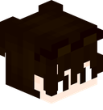
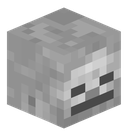
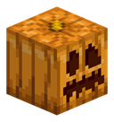
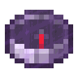
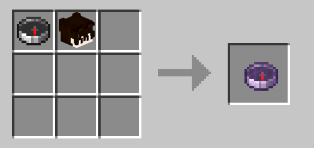
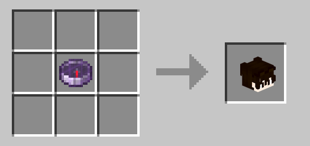

# Features and Mechanics

Death Outcomes introduces customizable mechanics that trigger when players die, turning deaths into tactical opportunities and trophies.

---

## 1. Player Head Drops

Whenever a player dies, the mod can drop an authentic **Player Head** item representing the fallen victim.

<table>
  <tr>
    <td align="center"> <b>Player Head</b></td>
    <td align="center"> <b>Skeleton Skull</b></td>
    <td align="center"> <b>Carved Pumpkin</b></td>
  </tr>
</table>

### Key Aspects:
* **Skin Profile Resolution**: The dropped head uses Minecraft's Data Component system to preserve the victim's exact skin textures, username, and 3D hat layer.
* **Smart PvP Detection (Direct and Indirect)**:
  * **Direct Kills**: Swords, axes, fists, and melee weapon strikes.
  * **Indirect Kills**: Bows, crossbows, tridents, lingering potions, splash potions, thrown projectiles, fireworks, or indirect magical damage originating from another player.
* **Suicide / Self-Damage Protection**: If PvP restriction is enabled (`dropPlayerHeadOnlyWhenKilledByPlayer = true`), self-inflicted deaths (such as falling, drowning, or harming yourself with an arrow/firework) will **not** trigger a head drop.
* **One-Time Head Drop Option (`dropPlayerHeadOnlyOnceEver`)**:
  * When set to `true`, each player can only drop their head once ever in the world's lifetime.
  * Subsequent deaths will never drop their head again, making each player head an ultra-rare limited trophy on your server.
  * Drop states are persistently stored in world data and survive server restarts.

---

## 2. Player Tracking Compass (Player's Compass)

  
   
  <b><i>Player's Compass</i></b>
   
  <i>Epic Rarity - Enchanted Glint - Real-time Tracking</i>

Combine a **Compass** and any **Player Head** in any 2x2 or 3x3 crafting grid to craft a **Player's Compass** (can be enabled or disabled via server configuration).

  
  
<i>Crafting Recipe: Compass + Player Head = Player's Compass</i>

### Key Aspects:
* **Distinctive Appearance**: Named `<Player>'s Compass` in dark purple text (`Epic` rarity) with an animated enchanted glint.
* **Live Location Tracking**: Uses vanilla Lodestone tracking data components (`tracked: false`) to point directly to the tracked player in real-time as they move.
* **Offline Location Persistence**: If the tracked player disconnects from the server, the compass smoothly retains their last known position and dimension (saved in world data across server restarts).
* **Cross-Dimension Handling**: If the tracked player is currently in a different dimension, the compass needle spins randomly (vanilla Lodestone behavior) until they return or you enter the same dimension.
* **100% Server-Side**: Functions cleanly with vanilla clients without needing any client-side mod installation.

### Optional Head Recovery / Dismantling:
If enabled in server settings (`enablePlayerCompassDismantleRecipe = true`), placing a Player's Compass alone into any crafting grid dismantles it and returns the original player head back:

  
  
<i>Dismantle Recipe: Player's Compass = Player Head</i>

---

## 3. Server-Side Compatibility

* **Vanilla Client Friendly**: When installed on a dedicated server, players joining with vanilla Minecraft clients (or any client without Death Outcomes installed) receive drops, tracking compasses, and crafting recipes correctly.
* **Multiplayer and SMP Ready**: Tailor the behavior to match your server's playstyle (e.g., hard-earned trophies in PvP or fun cosmetics in PvE).
